# MUBS Student Management System

A Laravel web application for managing students, courses, lecturers and course registrations at a university. Administrators manage the records, lecturers see their assigned courses and the students registered in them, and students see the available courses and their own registrations.

Built for **Coursework Two** of **Advanced Web Application Development (BUC3131)**, Bachelor of Business Computing, Year III, Semester I, Makerere University Business School, Academic Year 2026/2027.

Repository: https://github.com/joshuakyewalabye/mubs-student-management-system

Contents: [Features](#1-what-the-system-does) | [Stack](#2-technology-stack) | [Requirements](#3-requirements) | [Installation](#4-installation-from-clone-to-running) | [Logins](#5-sample-logins) | [Roles](#6-roles-and-permissions) | [Navigation](#7-how-to-navigate-the-system) | [How it works](#8-how-the-project-works) | [Database](#9-database-design) | [Requirement map](#10-where-each-requirement-is-implemented) | [Screenshots](#11-screenshots) | [Troubleshooting](#12-troubleshooting) | [Git workflow](#13-git-workflow-and-team)

---

## 1. What the system does

| Role | What they can do |
|---|---|
| **Administrator** | Add, view, edit and delete students and courses. Register a student for a course and remove a registration. Sees system-wide totals on the dashboard. |
| **Lecturer** | See only the courses assigned to them and the students registered in those courses. Cannot open another lecturer's course. |
| **Student** | See all available courses (details only, no list of other students) and their own registrations. |

Other features:
- Login, logout and a public sign-up page (a new sign-up always becomes a **student** and is linked to an existing student record with the same email, if there is one).
- A different dashboard for each role.
- Form validation with a red message under each wrong field, and green or red banners for success and error messages.
- A student cannot be registered twice for the same course (checked in the controller and enforced by a unique index in the database).
- Menu links and buttons (Add, Edit, Delete, New registration) only appear for users who have the matching permission.

## 2. Technology stack

| Layer | Technology |
|---|---|
| Language and framework | PHP, **Laravel 13** (developed and tested on PHP 8.5.10, Laravel 13.39.0) |
| Database | **MySQL** (XAMPP), accessed through **Eloquent ORM** |
| Authentication | Laravel session authentication with a hand-written `AuthController` (login, register, logout) |
| Roles and permissions | **spatie/laravel-permission** |
| Views | **Blade** templates with a reusable layout and partials |
| Styling and icons | **Tailwind CSS** and **Lucide** icons, loaded from CDNs (there is no npm or Vite build step) |
| Development server | `php artisan serve` |
| Version control | Git and GitHub (`main`, `develop`, feature branches, pull requests) |

## 3. Requirements

- **PHP** at the version Laravel 13 requires (the project was built on 8.5.10), with the `pdo_mysql` extension enabled (it is by default in XAMPP)
- **Composer**
- **MySQL** (for example the one in **XAMPP**; start MySQL in the XAMPP Control Panel before you begin)
- **Git**
- A browser with internet access, because Tailwind CSS and the icons load from CDNs
- Node.js and npm are **not** needed

## 4. Installation (from clone to running)

Run every command in a terminal (PowerShell on Windows). Each step must finish before the next one.

### Step 1: Clone the repository

```bash
git clone https://github.com/joshuakyewalabye/mubs-student-management-system.git
cd mubs-student-management-system
```

The `main` branch holds the stable version. Everything below is run from inside this project folder.

### Step 2: Install the PHP dependencies

```bash
composer install
```

This reads `composer.json` and downloads Laravel and spatie/laravel-permission into a `vendor/` folder (the repository does not contain `vendor/`).

### Step 3: Create your `.env` file

The `.env` file holds settings for your own computer and is not in Git. Copy the template:

```bash
# Windows (PowerShell or Command Prompt)
copy .env.example .env

# macOS or Linux
cp .env.example .env
```

### Step 4: Generate the application key

```bash
php artisan key:generate
```

This writes a random `APP_KEY` into `.env`. Laravel uses it to encrypt sessions and cookies; the app will not run without it.

### Step 5: Create an empty database

Start **MySQL** in XAMPP, open **phpMyAdmin** (http://localhost/phpmyadmin), choose **New**, and create a database named **`mubs_sms`** with collation **`utf8mb4_unicode_ci`**.

Or run this SQL in the SQL tab:

```sql
CREATE DATABASE mubs_sms CHARACTER SET utf8mb4 COLLATE utf8mb4_unicode_ci;
```

### Step 6: Point `.env` at the database

Open `.env` and set the database lines like this (the template may default to SQLite, so change or replace its `DB_` lines):

```
DB_CONNECTION=mysql
DB_HOST=127.0.0.1
DB_PORT=3306
DB_DATABASE=mubs_sms
DB_USERNAME=root
DB_PASSWORD=
```

`root` with an empty password is the XAMPP default. If your MySQL has a password, put it after `DB_PASSWORD=`.

### Step 7: Create the tables and the sample data

```bash
php artisan migrate:fresh --seed
```

- `migrate:fresh` drops every table in `mubs_sms` and rebuilds it from the files in `database/migrations/`.
- `--seed` then runs the seeders in `database/seeders/`: roles and permissions, users, students, courses and registrations.

You should see five seeders listed, each followed by `DONE`. If no seeder names appear, see [Troubleshooting](#12-troubleshooting).

To check the data, run:

```bash
php artisan tinker --execute="echo App\Models\User::count().' users, '.App\Models\Student::count().' students, '.App\Models\Course::count().' courses, '.App\Models\CourseRegistration::count().' registrations';"
```

Expected: `9 users, 6 students, 19 courses, 16 registrations`.

### Step 8: Start the application

```bash
php artisan serve
```

Open **http://127.0.0.1:8000/login** in your browser (if the terminal prints another port, use that one).

### Step 9: Log in

Use one of the [sample logins](#5-sample-logins). Every password is `password`.

> To reset the data at any time, run `php artisan migrate:fresh --seed` again. Running `php artisan db:seed` on its own is also safe: it does not create duplicate records.

## 5. Sample logins

All passwords are **`password`**.

| Role | Name | Email |
|---|---|---|
| Administrator | System Administrator | `admin@mubs.ac.ug` |
| Lecturer | Dr. Bashir Mutebi | `bashir.mutebi@mubs.ac.ug` |
| Lecturer | Mr. Mosh Gyagenda | `mosh.gyagenda@mubs.ac.ug` |
| Student | Matovu Mathew Philip (24/U/16689/EVE) | `mathew.matovu@mubs.ac.ug` |
| Student | Kyewalabye Joshua Joram (24/U/0611) | `joshua.kyewalabye@mubs.ac.ug` |
| Student | Kushaba Adrona (24/U/0594) | `adrona.kushaba@mubs.ac.ug` |
| Student | Magumba Benjamin Samuel (24/U/23155) | `benjamin.magumba@mubs.ac.ug` |
| Student | Magala Eric (24/U/0659) | `eric.magala@mubs.ac.ug` |
| Student | Kazosi Sharif (24/U/15620/EVE) | `sharif.kazosi@mubs.ac.ug` |

Seeded data: 19 courses (the 19 MUBS degree programmes, for example BCOM, BACC, BBC; 3 credits each), shared between the two lecturers, and 16 registrations spread over the 6 students.

## 6. Roles and permissions

Roles are `administrator`, `lecturer` and `student`. The code checks **permissions**, not role names, so a role's powers can change in one place (`RolesAndPermissionsSeeder`).

| | Administrator | Lecturer | Student |
|---|---|---|---|
| Permissions | all 14 | `view assigned courses` | `view courses`, `view own registrations` |
| Sidebar links | Dashboard, Students, Courses, Registrations | Dashboard, Courses | Dashboard, Courses, Registrations |
| Students pages | allowed | 403 | 403 |
| Courses list | all courses, Add, Edit, Delete | own courses only | all courses, no buttons |
| Course detail | any course, with registered students | own courses only, with registered students; 403 for another lecturer's course | any course, details only |
| Registrations | all, New registration, Delete | 403 | own registrations only, no buttons |

The 14 permissions: `view students`, `create students`, `edit students`, `delete students`, `view courses`, `create courses`, `edit courses`, `delete courses`, `view registrations`, `create registrations`, `delete registrations`, `manage users`, `view assigned courses`, `view own registrations`.

A user who is logged in but lacks the permission for a page gets a **403** page. A visitor who is not logged in is sent to the login page.

## 7. How to navigate the system

After login you land on the **Dashboard**. The left **sidebar** shows only the pages your role may open; your name and role are shown in the sidebar and the header, and **Sign out** is in the header.

### As the administrator (`admin@mubs.ac.ug`)
1. **Dashboard**: totals of students, courses and registrations, and the latest 5 registrations.
2. **Students**: search by name, student number or email. **Add student** opens the form. Click a student's name to see their registered courses. The pencil icon edits, the bin icon deletes (after a confirmation; the student's registrations are removed too).
3. **Courses**: search by code or title. **Add course** (with a lecturer dropdown), edit and delete. Click a course code to see its details and the registered students.
4. **Registrations**: the list of all registrations with search. **New registration** has a student dropdown and a course dropdown; choosing a pair that already exists shows a red error. The bin icon removes a registration.

### As a lecturer (`bashir.mutebi@mubs.ac.ug`)
- **Dashboard**: the number of own courses, the number of students in them and the latest 5 registrations in own courses.
- **Courses**: only the courses assigned to this lecturer. Open one to see the students registered in it. Typing the URL of another lecturer's course (for example `/courses/2` as Bashir) gives 403.

### As a student (`joshua.kyewalabye@mubs.ac.ug`)
- **Dashboard**: own registrations count, courses available and own latest 5 registrations.
- **Courses**: all courses, view only; the course page does not list other students.
- **Registrations**: only this student's own registrations.

### Creating a new student account
Go to **/register**, sign up with an email, and you become a student. If the administrator already added a student record with that same email, your account is linked to it automatically, and you see your own registrations. A student never types a student number: the administrator enters it when adding the record.

### Main URLs

| URL | Method | Needs permission | Purpose |
|---|---|---|---|
| `/login`, `/register` | GET, POST | none (guests only) | Sign in, sign up |
| `/logout` | POST | logged in | Sign out |
| `/dashboard` | GET | logged in | Role-specific dashboard |
| `/students` | GET | `view students` | List and search |
| `/students/create`, `/students` | GET, POST | `create students` | Add a student |
| `/students/{id}` | GET | `view students` | Student detail with courses |
| `/students/{id}/edit`, `/students/{id}` | GET, PUT | `edit students` | Edit a student |
| `/students/{id}` | DELETE | `delete students` | Delete a student |
| `/courses` | GET | `view courses` or `view assigned courses` | List and search |
| `/courses/create`, `/courses` | GET, POST | `create courses` | Add a course |
| `/courses/{id}` | GET | `view courses` or `view assigned courses` | Course detail |
| `/courses/{id}/edit`, `/courses/{id}` | GET, PUT | `edit courses` | Edit a course |
| `/courses/{id}` | DELETE | `delete courses` | Delete a course |
| `/registrations` | GET | `view registrations` or `view own registrations` | List and search |
| `/registrations/create`, `/registrations` | GET, POST | `create registrations` | Register a student for a course |
| `/registrations/{id}` | DELETE | `delete registrations` | Remove a registration |

The full list is in `routes/web.php`, or run `php artisan route:list`.

## 8. How the project works

### 8.1 What happens on every request

1. The browser requests a URL, for example `DELETE /students/3`.
2. `routes/web.php` finds the matching route and its name (`students.destroy`).
3. The route's **middleware** runs first: `auth` (is the user logged in?) and `permission:delete students` (does the user's role hold that permission?). If either fails, the user is redirected to login or gets a 403, and the controller never runs.
4. The **controller method** runs (`StudentController@destroy`). Laravel finds the `Student` row with id 3 from the URL ("route model binding") and passes it in.
5. The controller uses **Eloquent models** to read or write MySQL (`$student->delete()`). The database then removes that student's rows in `course_registrations` by itself (`cascadeOnDelete`).
6. The controller returns a **redirect** with a flash message (`->with('success', ...)`) or a **Blade view** (`return view('students.index', compact('students'))`).
7. The view extends `layouts/app.blade.php` (header, sidebar, content, footer). The `alerts` partial prints the green or red banner from the flash message.

### 8.2 Authentication

`AuthController` handles the login form, sign-up and sign-out. `Auth::attempt()` finds the user by email and compares the typed password with the stored hash. On success the session is regenerated (protection against session fixation). Passwords are stored with `Hash::make()`, never as plain text. Sign-out invalidates the session and issues a new CSRF token.

### 8.3 Authorization (three layers)

1. **Routes**: every route in `routes/web.php` sits inside the `auth` group and has its own `permission:` middleware. The middleware aliases are defined in `bootstrap/app.php`.
2. **Controllers**: some rules depend on the record, not just the role. For example, `CourseController@show` returns 403 when a lecturer opens a course that is not theirs, and `RegistrationController@index` filters a student's list to their own `student_id`. This stops one user reading another user's records.
3. **Views**: `@can` and `@canany` in Blade hide links and buttons the user may not use (for example the Add, Edit and Delete buttons).

### 8.4 Validation and messages

Every form is validated in the controller with `$request->validate([...])`. On failure Laravel returns to the form, keeps what was typed (`old()`), and the view prints each error under its field (`@error`). Rules include required fields, `unique` student number, email and course code (a record may keep its own value when edited, using `Rule::unique(...)->ignore(...)`), `between:1,10` for credits, and `exists` for chosen ids. Success and error banners come from `->with('success', ...)` and `->with('error', ...)`.

### 8.5 Preventing duplicate registrations

Two layers protect `course_registrations`:
1. `RegistrationController@store` checks whether the pair (student, course) exists and replies "This student is already registered for that course."
2. A **composite unique index** on `(student_id, course_id)` makes MySQL itself refuse a duplicate; the controller catches that error (code 1062) and shows the same friendly message.

### 8.6 Folder map

```
app/
  Http/Controllers/    AuthController, DashboardController, StudentController,
                       CourseController, RegistrationController
  Models/              User, Student, Course, CourseRegistration
bootstrap/app.php      middleware aliases: role, permission, role_or_permission
database/
  migrations/          users, students, courses, course_registrations, permission tables
  seeders/             DatabaseSeeder, RolesAndPermissionsSeeder, UsersSeeder,
                       StudentsSeeder, CoursesSeeder, CourseRegistrationsSeeder
resources/views/
  layouts/             app.blade.php (main layout), guest.blade.php (login pages)
  partials/            header, sidebar, footer, alerts
  auth/                login, register
  students/            index, show, create, edit, _form
  courses/             index, show, create, edit, _form
  registrations/       index, create
  dashboard.blade.php  one page, three role-specific versions
routes/web.php        all routes, each with its middleware
docs/                  contribution report and screenshots
```

## 9. Database design

Database: `mubs_sms`.

| Table | Important columns |
|---|---|
| `users` | `id`, `name`, `email` (unique), `password`. Administrators, lecturers and students all log in through this table. |
| `students` | `id`, `user_id` (nullable, unique, foreign key to `users`), `student_number` (unique), `name`, `email` (unique), `phone` (nullable) |
| `courses` | `id`, `code` (unique), `title`, `credits`, `lecturer_id` (nullable, foreign key to `users`) |
| `course_registrations` | `id`, `student_id` (foreign key, cascade on delete), `course_id` (foreign key, cascade on delete), unique `(student_id, course_id)` |
| `roles`, `permissions`, `model_has_roles`, `model_has_permissions`, `role_has_permissions` | created by spatie/laravel-permission |

### Eloquent relationships

| Relationship | Type | Defined in | Key |
|---|---|---|---|
| Student to courses | `belongsToMany` | `Student::courses()` | pivot table `course_registrations` |
| Course to students | `belongsToMany` | `Course::students()` | pivot table `course_registrations` |
| Student to registrations | `hasMany` | `Student::registrations()` | `course_registrations.student_id` |
| Course to registrations | `hasMany` | `Course::registrations()` | `course_registrations.course_id` |
| Registration to student / course | `belongsTo` | `CourseRegistration::student()`, `::course()` | `student_id`, `course_id` |
| Course to lecturer | `belongsTo` | `Course::lecturer()` | `courses.lecturer_id` to `users.id` |
| Lecturer (user) to courses | `hasMany` | `User::courses()` | `courses.lecturer_id` |
| Student to user | `belongsTo` | `Student::user()` | `students.user_id` |
| User to student | `hasOne` | `User::student()` | `students.user_id` |

Retrieving the data with Eloquent:

```php
$student->courses;   // the courses a student is registered for
$course->students;   // the students registered for a course
```

## 10. Where each requirement is implemented

| Question | Where |
|---|---|
| Q1 Database and relationships | `database/migrations/`, `app/Models/`, unique index in the `course_registrations` migration |
| Q2 Seeders | `database/seeders/` (run in order by `DatabaseSeeder`) |
| Q3 Authentication, roles, permissions | `AuthController`, `RolesAndPermissionsSeeder`, `UsersSeeder`, `routes/web.php`, `bootstrap/app.php`, record checks in the controllers |
| Q4 Application functionality | `StudentController`, `CourseController`, `RegistrationController`, `DashboardController` |
| Q5 Blade layouts and validation | `resources/views/layouts/`, `partials/`, `students/`, `courses/`, `registrations/`; validation in the controllers; `@can` in the views |
| Q6 Documentation | this README and `docs/` |

## 11. Screenshots

All screenshots were taken on a freshly seeded database (`php artisan migrate:fresh --seed`).

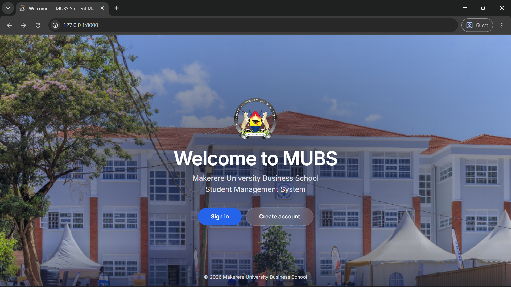
*This is the landing page.*

### Sign in
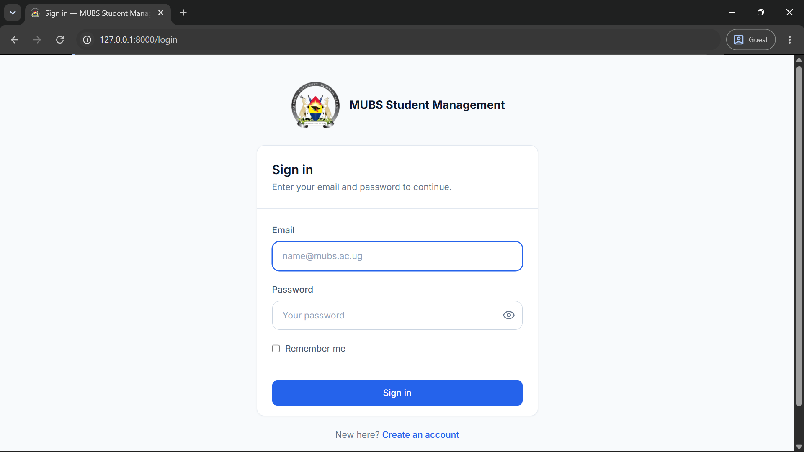
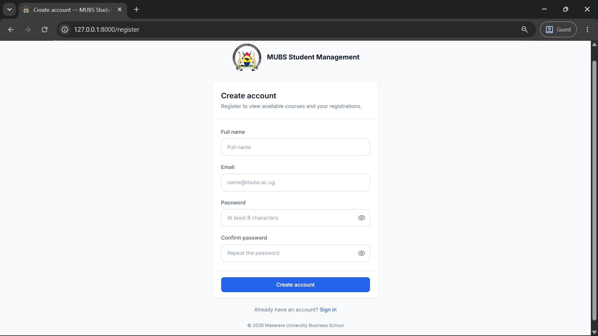

### Administrator
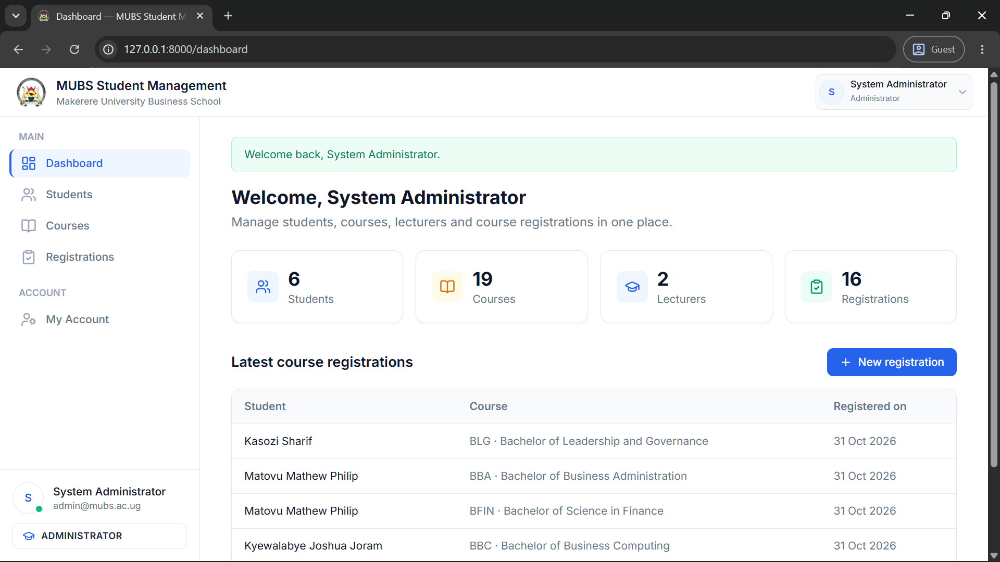
*Administrator dashboard.*

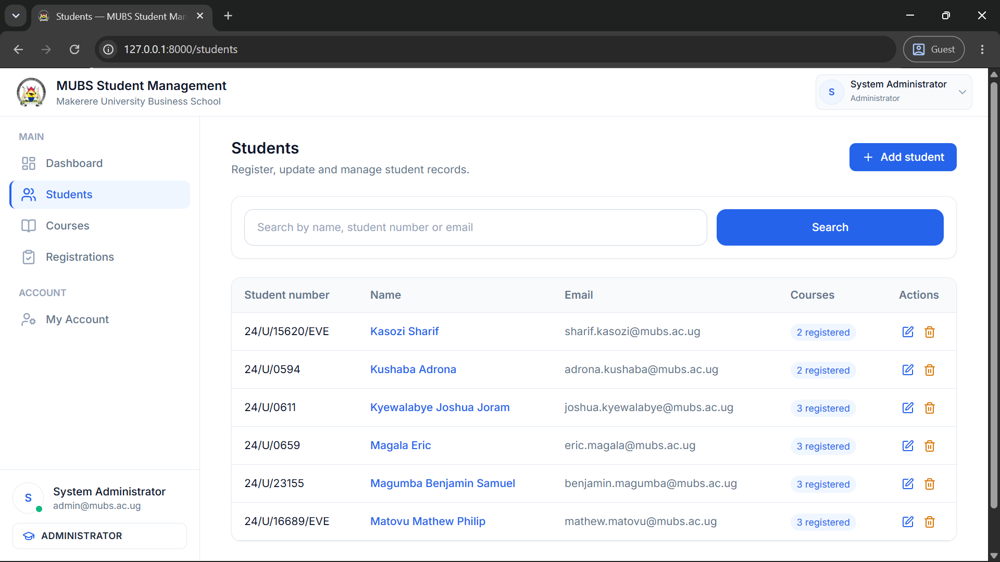
*Students list with search, Add student, and Edit and Delete actions.*

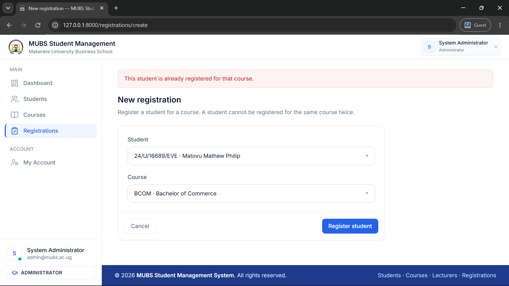
*Adding a student with a student number and email that already exist.*

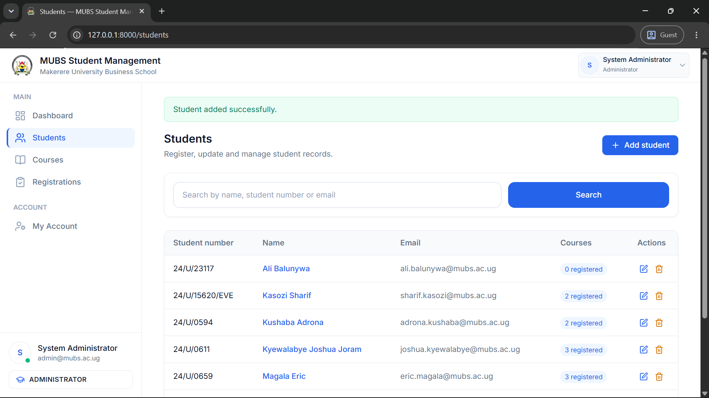
*Success message after adding a student.*


*Student detail page listing the registered courses.*

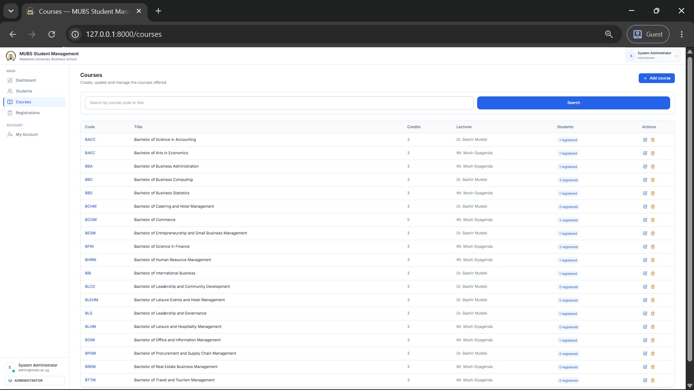
*All 19 courses with lecturer and registered-student count.*

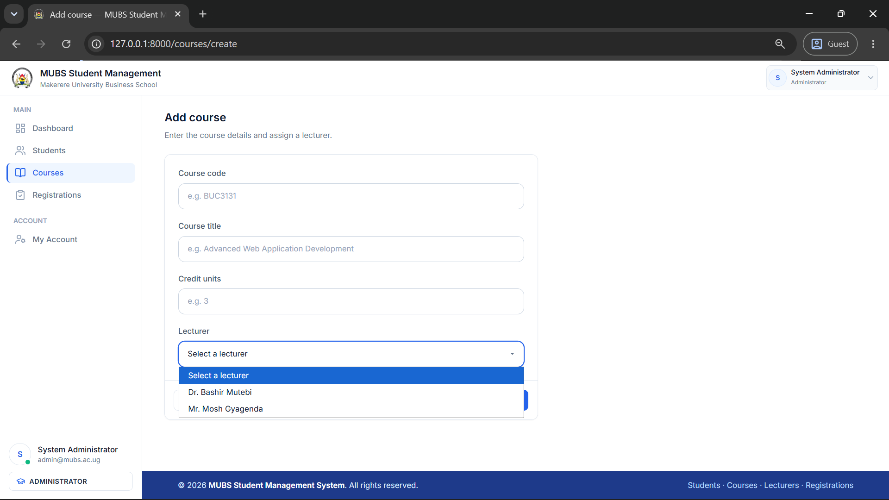
*Add course form with the lecturer dropdown.*

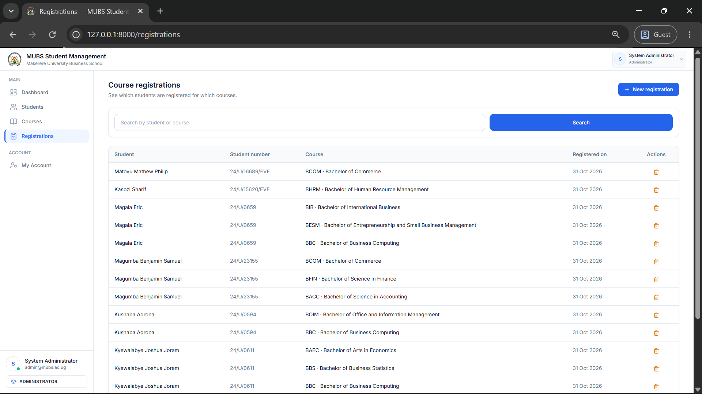
*Course detail with the registered students.*


*All 16 registrations.*


*Registering a student who is already registered for the course.*

### Student
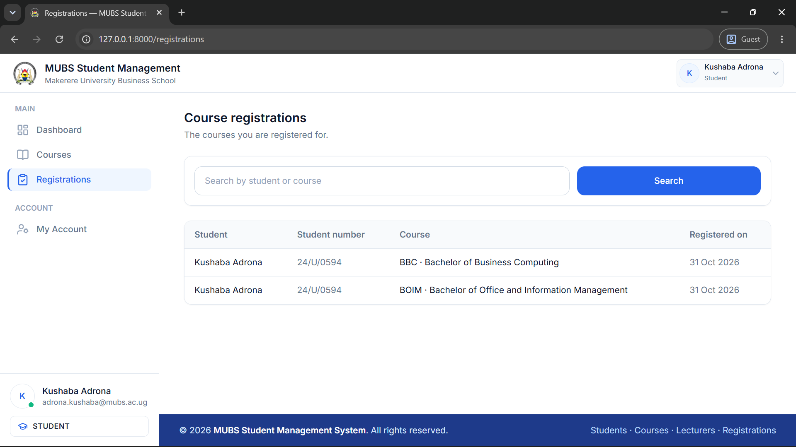
*A student sees only their own registrations and a limited sidebar.*

### Lecturer
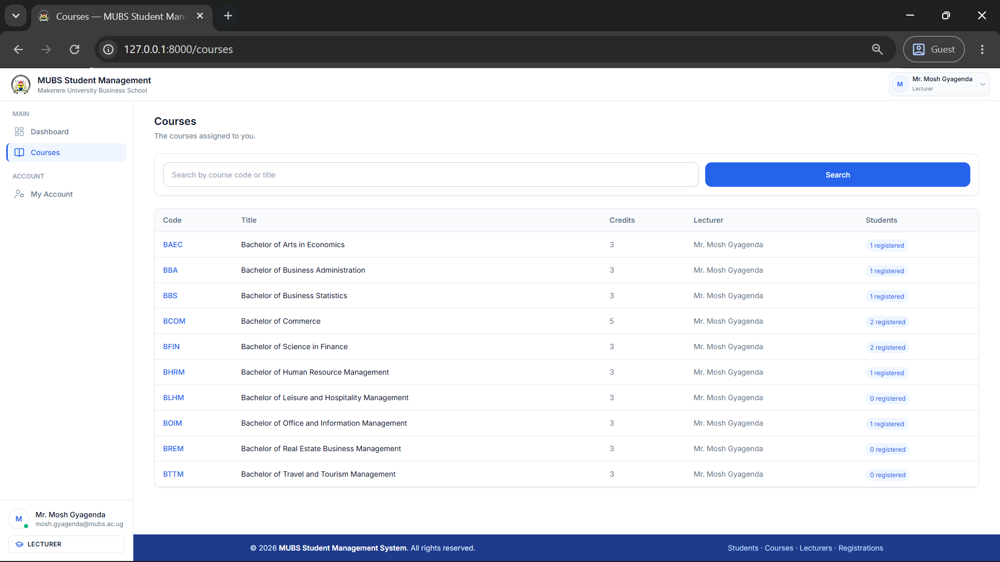
*A lecturer sees only their own courses.*

### Access control
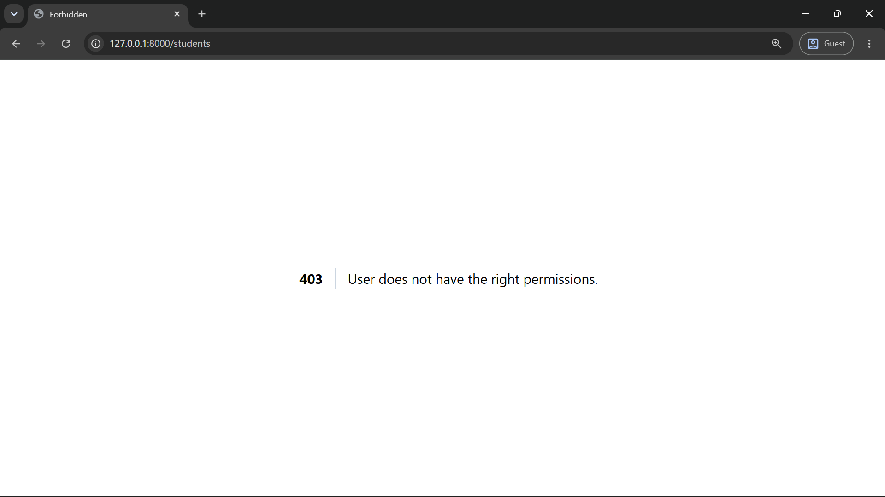
*A student opening `/students` gets 403.*

## 12. Troubleshooting

| Problem | Fix |
|---|---|
| `Class "..." not found` or no `vendor` folder | Run `composer install`. |
| `No application encryption key has been specified` | Run `php artisan key:generate`. |
| `SQLSTATE[HY000] [2002]` connection refused, or `Unknown database 'mubs_sms'` | Start **MySQL** in XAMPP, create the database `mubs_sms` (Step 5), and check the `DB_` lines in `.env` (Step 6). |
| `php artisan migrate:fresh --seed` prints no seeder names, or the tables are empty | Open `database/seeders/DatabaseSeeder.php` and check that it calls all five seeders in this order: `RolesAndPermissionsSeeder`, `UsersSeeder`, `StudentsSeeder`, `CoursesSeeder`, `CourseRegistrationsSeeder`. |
| Pages look unstyled or icons are missing | Tailwind CSS and the icons load from CDNs; check your internet connection. |
| `.env` changes seem ignored | Run `php artisan config:clear`, then restart `php artisan serve`. |
| Port 8000 is busy | `php artisan serve --port=8001` |
| A login says "The email or password is incorrect" | Use an email from the [sample logins](#5-sample-logins); the password is `password`. Run `php artisan migrate:fresh --seed` if the data was changed. |

## 13. Git workflow and team

- `main` holds stable code and `develop` is the integration branch.
- Every member works on their own `feature/...` branch, commits with meaningful messages, and opens a pull request into `develop`. The integrated application is tested before `develop` is merged into `main`.
- The members, their tasks, branches, pull requests and contributions are listed in [`docs/CONTRIBUTION_REPORT.md`](docs/CONTRIBUTION_REPORT.md).
